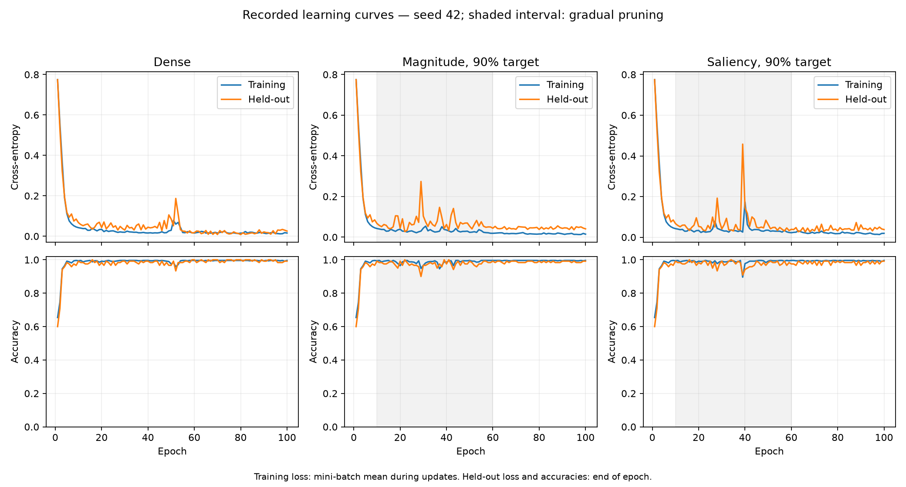

# AQUA Self-Pruning Neural Network

A complete, self-pruning neural network written entirely from scratch in **Python 3.10+ and NumPy**, without PyTorch, TensorFlow, JAX, or any autograd/ML libraries.

Developed for the Tredence AQUA technical challenge, this codebase demonstrates:
1. An exact, reverse-topological autodiff computational engine.
2. Training of an MLP with a custom Adam optimizer on non-linear synthetic spiral classification.
3. Mathematically principled network self-pruning using **Magnitude** and **First-Order Taylor Saliency** on a cubic schedule.
4. Hard budget enforcement reaching the exact integer target connection counts without weight revival.
5. Systems-level cost analysis comparing theoretical Multiply-Accumulate (MAC) savings against empirical BLAS latency.

---

## Quickstart & Setup

### Environment Setup (Windows PowerShell)

```powershell
# From the repository root:
py -m venv .venv
.\.venv\Scripts\Activate.ps1
python -m pip install --upgrade pip
python -m pip install -e .
```

*Note on Python Version:* Developed and verified on Python 3.14.2 (compatible with Python 3.10+).

---

## Stable Command Contracts

### 1. Automated Correctness Checks
Run the comprehensive finite-difference gradient and masking test suites:

```powershell
# Check analytical gradients against central differences (82 tests)
python -m pytest tests/test_gradients.py -v

# Check masking, gradient policy, Adam states, and learning integration (33 tests)
python -m pytest tests/test_masking.py -v

# Run the complete test suite
python -m pytest -q
```

### 2. Training and Self-Pruning

#### Baseline Mode (Dense Training)
```powershell
python -m train.train --mode baseline --epochs 100 --seed 42
```
*Expected Output:* Test accuracy converges from ~33% random chance to >99%.

#### Self-Pruning Mode (Taylor Saliency at 90% Target Sparsity)
```powershell
python -m train.train --mode prune --method saliency --sparsity 0.90 --epochs 100 --seed 42
```
*Expected Output:* Prunes 3,974 of 4,416 weights between epochs 10 and 60, achieving exact 89.99% sparsity (442 active connections) while maintaining >99% test accuracy.

#### Self-Pruning Mode (Magnitude Baseline at 90% Target Sparsity)
```powershell
python -m train.train --mode prune --method magnitude --sparsity 0.90 --epochs 100 --seed 42
```

### 3. Reproducible Multi-Sparsity Benchmark Sweep
Runs all 5 target sparsities (0%, 50%, 75%, 90%, 95%) across 3 fixed seeds for both methods, produces a Pareto plot, and benchmarks dense vs. sparse forward paths:

```powershell
python -m experiments.benchmark --seeds 3 --epochs 100 --output-dir results/verified --reference-results results/benchmark_results.json
```

---

## Experimental Results & Evidence

### Pareto Frontier Summary (3 Fixed Seeds: 42, 43, 44)

| Method | Target Sparsity | Achieved Sparsity | Active / Total Weights | Test Accuracy (Mean ± Std) |
|---|---|---|---|---|
| **Magnitude** | 0% (Dense) | 0.00% | 4,416 / 4,416 | 98.6% ± 1.4% |
| **Magnitude** | 50% | 50.00% | 2,208 / 4,416 | 98.9% ± 1.0% |
| **Magnitude** | 75% | 75.00% | 1,104 / 4,416 | 98.3% ± 1.8% |
| **Magnitude** | 90% | 89.99% | 442 / 4,416 | 98.6% ± 1.4% |
| **Magnitude** | 95% | 95.00% | 221 / 4,416 | 98.9% ± 1.0% |
| **Saliency** | 0% (Dense) | 0.00% | 4,416 / 4,416 | 98.6% ± 1.4% |
| **Saliency** | 50% | 50.00% | 2,208 / 4,416 | 98.6% ± 0.8% |
| **Saliency** | 75% | 75.00% | 1,104 / 4,416 | 99.2% ± 1.2% |
| **Saliency** | 90% | 89.99% | 442 / 4,416 | 98.6% ± 1.4% |
| **Saliency** | 95% | 95.00% | 221 / 4,416 | 98.3% ± 1.4% |

*(Chance accuracy on 3-class spirals is 33.3%)*

### Pareto Plot
The historical Accuracy vs. Sparsity curve is saved to `results/pareto_plot.png`. The verified reproduction writes `results/verified/pareto_plot.png`, complete trained model snapshots, and `results/verified/EVIDENCE.md`. Error bars represent population standard deviations across seeds, not confidence intervals.

---

## Verified Cost Evidence and Reproduction

The verified benchmark measures the **exact trained saliency model** represented in the Pareto sweep. It exports final weights, biases, masks, configuration, and epoch histories as inference-only `.npz` snapshots. A model fingerprint links each snapshot to the accuracy row and timing result. Loading a snapshot does not resume training or restore an optimizer.

Before timing, the benchmark recreates the held-out split, checks its accuracy and loss against the recorded values, and compares all inference paths against the training model's logits. Timing excludes conversion and autodiff graph construction, includes warmups and repeated measurements, rotates backend order, and reports median and p95 latency.

At the 90% target, 442 of 4,416 weights remain active: **89.9909% achieved sparsity**. A sparse-aware path executes 442 weight MACs per sample instead of 4,416. Bias and activation operations are excluded. This does not reduce the work of the dense training path or guarantee lower inference latency.

See [the generated evidence report](results/verified/EVIDENCE.md) and [raw verified results](results/verified/benchmark_results.json) for the measured timings, paired method differences, environment, and model identity. The report derives its values from the JSON. An unchanged mean accuracy across three seeds does not establish statistical equivalence or generalization to other tasks. Saliency is not consistently better than magnitude in the recorded experiment.

Historical reference results directly under `results/` remain in the submission for regression comparison. Their original latency measurements used an untrained proxy model with unseeded random pruning scores; use `results/verified/` for trained-classifier cost evidence. The optional stress experiment `experiments/robustness.py` and historical `results/optimization/` folder are retained locally and excluded from the submission by `.gitignore`. No submission command or test imports the optional stress experiment.

For inference across batch sizes 1, 16, and 128 on the saved trained saliency models, first run the sweep above, then:

```powershell
python -m experiments.optimization_benchmark --benchmark-results results/verified/benchmark_results.json --output-dir results/verified/optimization
```

Memory figures count NumPy array payload for each representation. They exclude Python object overhead, temporary arrays, and total process memory. The comparison engine keeps the original model and all representations, so payload savings are not total-engine memory savings. Cached dense inference still performs dense matrix multiplication.

To regenerate the evidence narrative without retraining:

```powershell
python -m experiments.evidence_report results/verified/benchmark_results.json
```

For this correction, [the recorded state regression](results/verified/state_regression.json) confirms exact before/after agreement of weights, masks, gradients, Adam moments, and all epoch metrics for seed 42 dense, magnitude-pruned, and saliency-pruned 100-epoch runs. The full sweep additionally checks every historical accuracy, loss, and connection-count row across seeds 42, 43, and 44.

The default training commands and returned result dictionaries are unchanged. To explicitly save a final inference snapshot:

```powershell
python -m train.train --mode prune --method saliency --sparsity 0.90 --epochs 100 --seed 42 --snapshot results/verified/saliency_seed42.npz
```

For the reference dependency versions, use `python -m pip install -r requirements-reproduce.txt` followed by `python -m pip install -e .`. The recorded runs use Python 3.14.2. Deterministic training metrics and masks can be compared exactly on that environment; wall-clock latency varies with hardware and machine load.

---

## Submission File Architecture

The case study suggests `engine/`, `nn/`, `prune/`, `train/`, and `tests/`; it also requires installation/run instructions, design reasoning, and committed Part 4 plots and raw numbers. This repository follows those folders and adds `experiments/` and `results/` for the required evidence.

```text
aqua_selfpruning/
├── .gitignore
├── README.md
├── DESIGN.md
├── pyproject.toml
├── requirements-reproduce.txt
├── engine/
│   ├── tensor.py                    # Graph, gradients, backward ordering
│   └── operations.py                # Required differentiable operations
├── nn/
│   ├── layers.py                    # Masked Linear layers and MLP
│   └── optimizers.py                # Adam and pruning-state protection
├── prune/
│   ├── importance.py                # Magnitude and derived Taylor saliency
│   └── scheduler.py                 # Gradual pruning and integer budgets
├── train/
│   ├── dataset.py                   # Seeded spirals and mini-batches
│   ├── train.py                     # Baseline and self-pruning training
│   └── snapshot.py                  # Exact trained weights/masks for evidence
├── experiments/
│   ├── benchmark.py                 # Required Pareto sweep and real cost
│   ├── optimized_inference.py       # Dense and sparse-aware execution paths
│   ├── inference_validation.py      # Helpers used by equivalence tests
│   ├── optimization_benchmark.py    # Trained-model batch-size cost comparison
│   └── evidence_report.py           # Narrative generated from measured JSON
├── tests/
│   ├── test_gradients.py            # Finite-difference checks
│   ├── test_masking.py              # Masks, Adam, budgets, training integration
│   ├── test_inference_equivalence.py
│   ├── test_benchmark_fairness.py
│   └── test_benchmark_evidence.py    # Provenance and unchanged training state
└── results/
    ├── baseline_seed42.json          # Saved training history
    ├── benchmark_results.json        # Historical accuracy regression reference
    ├── pareto_plot.png               # Historical reference plot
    └── verified/
        ├── benchmark_results.json    # Reproduced accuracy and trained-model cost
        ├── pareto_plot.png           # Required sparsity–accuracy curve
        ├── EVIDENCE.md               # Generated quantitative evidence
        ├── state_regression.json     # Before/after neural-state preservation
        ├── models/
        │   └── *.npz                 # 27 trained inference snapshots
        └── optimization/
            └── inference_benchmark_results.json
```

Keep every source/test file shown above: the additional helpers are dependencies of the current submission commands or tests, or reproduce the reported cost evidence. The model snapshots under `results/verified/models/` are included because the benchmark manifest identifies the exact trained weights and masks used to support its claims.

Local-only files excluded by `.gitignore`:

- `experiments/robustness.py`: optional distribution stress experiment beyond the mandatory sweep.
- `results/optimization/`: historical proxy-model timings, robustness outputs, and their legacy report. This is a different directory from the included `results/verified/optimization/`.
- `ANTIGRAVITY_AQUA_SIMPLE_SETUP.md`, `AQUA_SAFE_OPTIMIZATION_PLAN.md`, and `FILE_RESPONSIBILITY_AND_NECESSITY.md`: local planning/reference notes.
- Python bytecode, virtual environments, package/build outputs, and test/development caches.

The case study asks for full commit history. Excluding local-only files from the current submission does not rewrite or remove earlier commits.

## Learning Curves and Optimizer Edge-Case Evidence

Generate the loss/accuracy curves directly from the committed seed-42 dense, magnitude-90% and saliency-90% snapshot histories (no training occurs):

```powershell
python -m experiments.learning_curves
python -m pytest tests/test_revival_policy.py -v
```



Raw plotted histories and model hashes are in `results/verified/learning_curves.json`. Training loss averages mini-batch losses during updates; held-out loss and both accuracies are evaluated at epoch end. Shading marks the pruning interval. These selected curves illustrate training, while the Pareto results summarize all three seeds.

`DESIGN.md` now explains initialization, autodiff performance constraints, multi-tenant serving, and the revival policy. The supported layer API rejects revival atomically; the low-level Adam demonstration verifies cleared moments with the existing global bias-correction clock. It does not introduce a regrowth feature or change the trained model.

Additional submission files: `experiments/learning_curves.py`, `tests/test_revival_policy.py`, `results/verified/learning_curves.png`, `results/verified/learning_curves.json`, and `results/verified/submission_preservation.json`. The preservation manifest records executable AST hashes (excluding docstrings) for the existing engine, layers, optimizer, pruning and training modules, plus byte hashes of all trained snapshots, captured before these submission additions.
